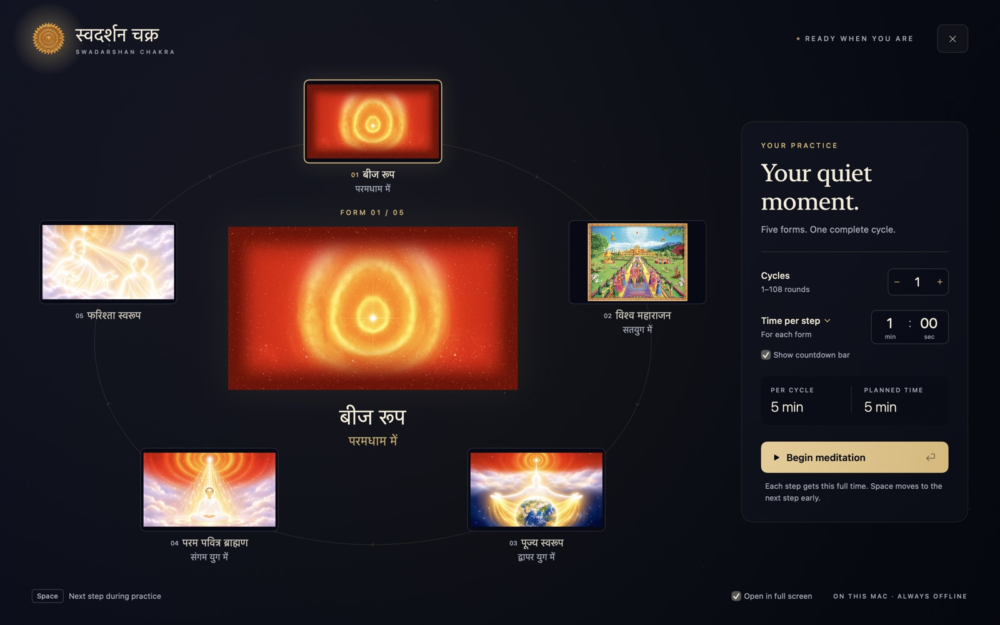
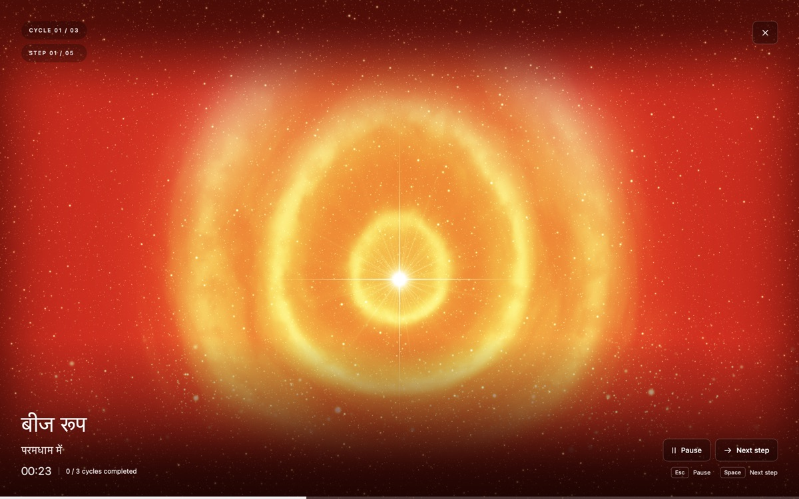
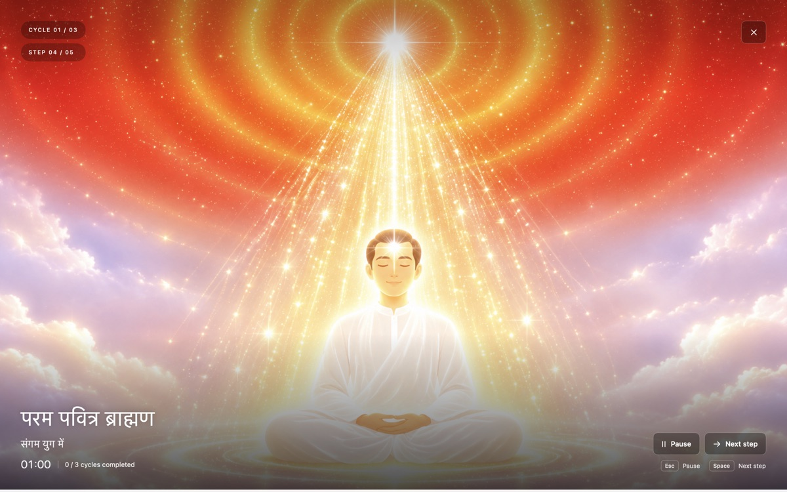
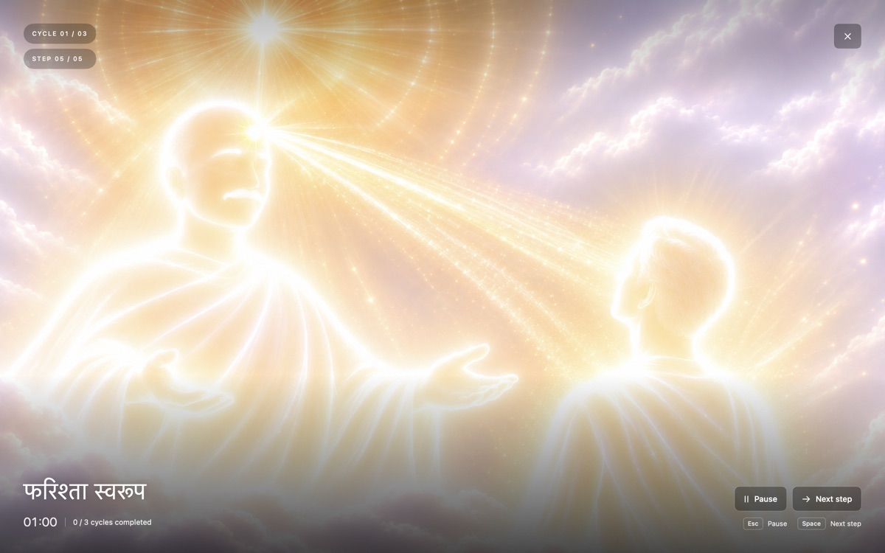
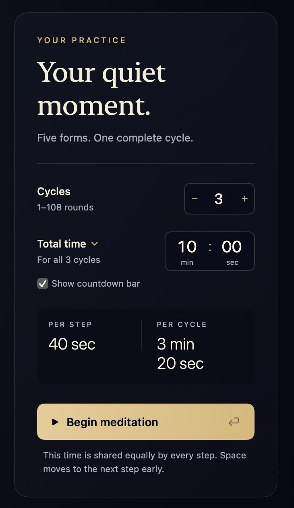
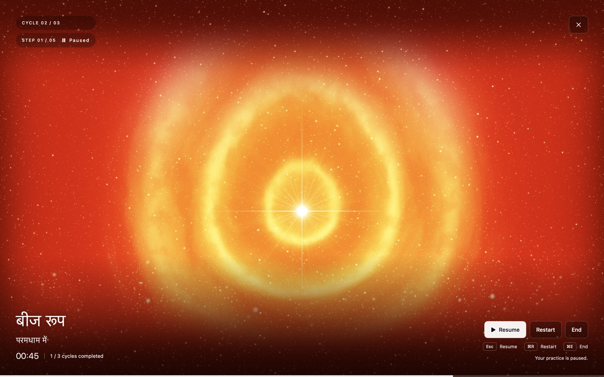
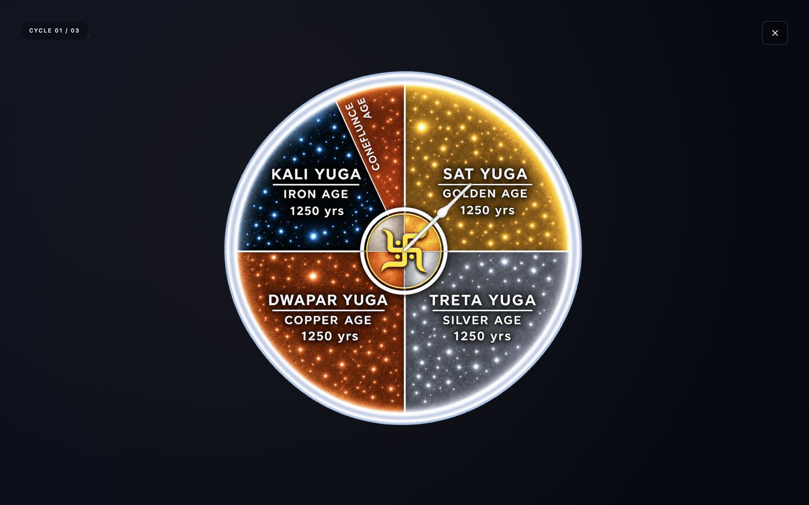
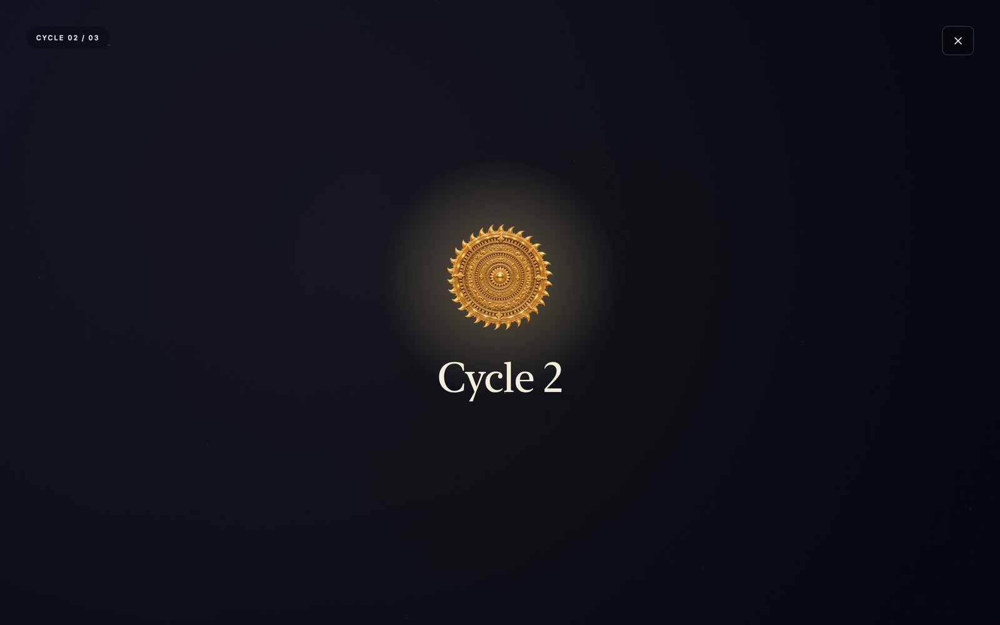
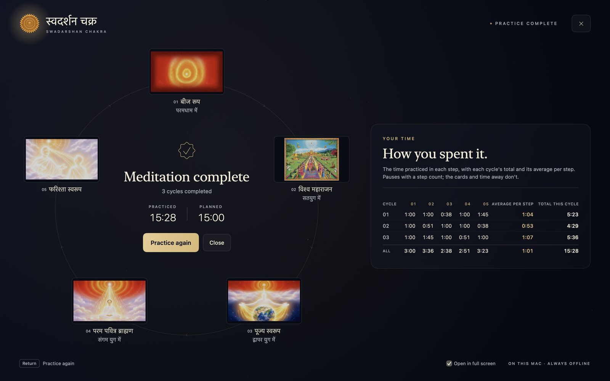
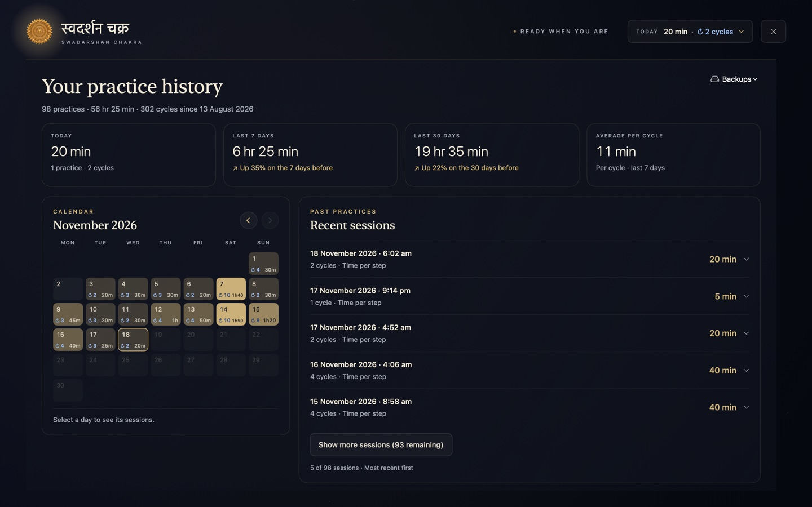

<p align="center">
  
</p>

<h1 align="center">Swadarshan Chakra</h1>

<p align="center">
  <b>स्वदर्शन चक्र</b> · a calm, full-screen companion for the Swadarshan Chakra meditation on your Mac
</p>

<p align="center">
  <a href="https://github.com/shivam13juna/Swadarshan-Chakra/releases/latest"><b>Download for Mac</b></a> · <a href="https://swadarshan-chakra.web.app"><b>Practice in your browser</b></a>
  <br>
  <sub>Mac app: macOS 13 Ventura or later · Apple Silicon · Free · Works entirely offline</sub>
</p>

<br>



## What it does

Swadarshan Chakra guides you through five consecutive forms of spiritual self-awareness, one at a time. Each form's picture fills your screen while you contemplate it. When its time is up, the hand on the cycle of ages turns to where the next form stands, and the next form begins. After the fifth, the circle starts again. One pass through all five forms is a **cycle**. At the end, you can see how you spent your time, step by step and cycle by cycle. Every practice is kept, and **your journey**, below the setup screen and beside every finished practice, shows how your practice is growing: a calendar of your days and their cycles, your trend, and the hours you tend to practice.

You choose how many cycles to practice and how much time to give them. The app keeps time, so you don't have to. Or practice freestyle, with no timer at all.

No Mac, or nothing to install? The same practice runs in any modern browser at **[swadarshan-chakra.web.app](https://swadarshan-chakra.web.app)**, on a computer or a phone. Your settings and your practice history stay in that browser, and a backup file carries your history between the browser and the Mac app.

### The five steps

<table>
  <tr>
    <td align="center" width="50%">
      <br>
      <b>1 · बीज रूप</b> — परमधाम में<br>
      <sub>Beej roop, Paramdham me</sub>
    </td>
    <td align="center" width="50%">
      <br>
      <b>2 · विश्व महाराजन</b> — सतयुग में<br>
      <sub>Vishwa Maharajan, Satyug me</sub>
    </td>
  </tr>
  <tr>
    <td align="center" width="50%">
      <br>
      <b>3 · पूज्य स्वरूप</b> — द्वापर युग में<br>
      <sub>Pujya Swaroop, Dwapar Yug me</sub>
    </td>
    <td align="center" width="50%">
      <br>
      <b>4 · परम पवित्र ब्राह्मण</b> — संगम युग में<br>
      <sub>Param Pavitra Brahmin, Sangam Yug me</sub>
    </td>
  </tr>
  <tr>
    <td align="center" colspan="2">
      <br>
      <b>5 · फरिश्ता स्वरूप</b><br>
      <sub>Farishta Swaroop</sub>
    </td>
  </tr>
</table>

## Install

1. Download **Swadarshan-Chakra-…-macOS-arm64.zip** from the [latest release](https://github.com/shivam13juna/Swadarshan-Chakra/releases/latest).
2. Open the zip and drag **Swadarshan Chakra** into your **Applications** folder.
3. Open it. The first time, macOS says it can't verify the app, because it isn't notarized by Apple. Click **Done**, open **System Settings → Privacy & Security**, scroll down, and click **Open Anyway**. You only need to do this once.

Swadarshan Chakra lives in your **menu bar** as a small gold chakra. Click it to open the meditation; right-click it to quit. Closing the window (the **×** at the top right, or <kbd>⌘</kbd> <kbd>W</kbd>) ends any practice, and the chakra opens the setup screen again.

> [!NOTE]
> On an Intel Mac, build the app from source. See [For developers](#for-developers).

## Your practice, step by step

### 1. Set it up



**Cycles:** anywhere from 1 to 108.

**Time:** click the drop-down to choose how you'd like to set it.

- **Time per step** gives every form the time you enter.<br>*1 minute per step → 5 minutes per cycle.*
- **Total time** is the time you have for the whole practice, shared equally by every step.<br>*10 minutes for 3 cycles → 40 seconds per step.*
- **Freestyle** has no timer at all. Stay with each form as long as you like, and press <kbd>Space</kbd> for the next.

With a timer, **Show countdown bar** puts a thin bar along the bottom of each step to show how much of its time is left. Untick it if you'd rather not see it.

Clicking a field selects its whole value, so you can type the new one straight away. The panel shows what your choice works out to. Press **Begin meditation** (or <kbd>Return</kbd>). Your settings are remembered for next time.

**Today**, at the top of the screen, shows how long you've practiced today and how many cycles. Click it, or scroll down, for [your journey](#your-journey).

<br clear="right">

### 2. Meditate

Each step fills your screen, as in [the five steps](#the-five-steps) above.

- The current **cycle** and **step** are in the top-left corner. The form's name and the time remaining are at the bottom.
- A thin white bar along the bottom edge shows how much of the step's time is left, unless you've turned it off. It is full as the step begins, empties as the time runs out, and holds still while paused.
- When a step's time is up, the next one begins by itself, after [a short card](#3-before-each-step) showing where it stands in the cycle of ages. Ready sooner? Press <kbd>Space</kbd>. In freestyle there is no countdown and no bar: each step waits for your <kbd>Space</kbd>.
- <kbd>Esc</kbd> pauses, and <kbd>Esc</kbd> again carries on, so you can stay longer with a step: its time waits while you're paused. From the pause you can also restart or end the practice. The pause screen shows the keys for all three.
- The **×** in the top-right corner (or <kbd>⌘</kbd> <kbd>W</kbd>) ends the practice and closes the window. The chakra in the menu bar opens the setup screen again.
- If you switch to another app or your Mac goes to sleep, the practice pauses and waits for you. Nothing moves on while you're away.



### 3. Before each step



Every step opens with a short card showing the cycle of ages, with a white hand fixed at the swastika's centre. The hand shows where the step stands in the cycle. Between steps it turns clockwise like a clock's, from where the step you've finished stands to where the next one does:

- Before step 1, **बीज रूप**: the hand stands at the top, where the Confluence Age meets Sat Yuga. It doesn't turn; this card follows the cycle's own card.
- Before step 2, **विश्व महाराजन**: from the top to Sat Yuga.
- Before step 3, **पूज्य स्वरूप**: on to Dwapar Yuga.
- Before step 4, **परम पवित्र ब्राह्मण**: on to the Confluence Age.
- Before step 5, **फरिश्ता स्वरूप**: a little further, near the end of the Confluence Age but short of the top. The age is ending, but it isn't over yet.

After three seconds the step begins on its own. Press <kbd>Space</kbd> to begin it right away. The card isn't counted as practice time, and every step still gets its full time.

### 4. A moment between cycles



Each cycle opens with a short card: *Cycle 1*, *Cycle 2*, and so on. After three seconds it gives way to step 1's card, and then the first step begins. Neither card is counted as practice time, and every step still gets its full time. <kbd>Space</kbd> on either card begins the step at once.

### 5. Finish



When the last cycle ends, the panel on the right shows how many cycles you completed and how long you actually practiced. That includes the time you spent paused with a step in front of you. Time away doesn't count: in another app, or with your Mac asleep or locked.

Below that, **Your time** shows how you spent it. Each cycle has a row with the time you gave each of the five steps, then **Average per step** and **Total this cycle**. With more than one cycle, a last row adds them all up. A long practice scrolls; the column titles and that last row stay in view.

On the left, in place of the circle, is [your journey](#your-journey), with this practice already in it. It scrolls on its own, so the panel stays in view.

Press <kbd>Return</kbd> to practice again.

## Your journey



Every practice is kept once it has a minute of practice or a whole cycle, however it ends: finished, ended from the pause screen, or with the window closed. Your journey is below the setup screen: scroll down, click **Today** at the top or **Your journey** at the foot of the circle, or press <kbd>⌘</kbd> <kbd>J</kbd> (<kbd>J</kbd> on the web). When a practice ends, it is beside your time.

- **Totals:** today, the last 7 and 30 days (each against the 7 or 30 days before), your streak of days in a row, and all your cycles. 108 cycles make a mala.
- **Calendar:** each day shaded by how long you practiced, with its cycles in blue at the bottom left and its time at the bottom right. Click a day to see its practices: when each began, how long it lasted, and its cycles.
- **Trend:** your last twelve weeks, and whether your practice is rising, steady, or easing off, from the last four weeks against the four before.
- **When you practice:** the hours of the week you tend to practice, over the last twelve weeks. Notes beside it name your quietest part of the day, a good time for another cycle, and count the mornings you practiced at amrit vela, between 3 and 5 am.

### Moving your history to another device

**Export backup…** saves every practice to a file, such as `Swadarshan Chakra backup 2026-11-18.json`. On another Mac, or in the web version, **Import backup…** adds the practices it doesn't have yet. Nothing is replaced, and importing the same file twice changes nothing, so you can carry your history back and forth: Mac to Mac, browser to browser, or between the Mac app and a browser, either way. In the Mac app, both are in the **File** menu too.

## Full screen or a window

Meditation opens in full screen, so nothing else competes for your attention. If you'd rather use an ordinary window, untick **Open in full screen** at the bottom of the setup screen.

You can also switch at any time, as in any Mac app: click the green window button (in full screen, move your pointer to the top of the screen to reveal it), choose **View ▸ Enter Full Screen**, or press <kbd>⌃</kbd> <kbd>⌘</kbd> <kbd>F</kbd>.

## Keyboard shortcuts

| Keys | Action |
|---|---|
| <kbd>Return</kbd> | Begin · Resume · Practice again |
| <kbd>Space</kbd> | Next step, or start a step right away from its card |
| <kbd>Esc</kbd> | Pause · Resume |
| <kbd>⌘</kbd> <kbd>J</kbd> | Down to your journey |
| <kbd>⇧</kbd> <kbd>⌘</kbd> <kbd>E</kbd> / <kbd>⇧</kbd> <kbd>⌘</kbd> <kbd>I</kbd> | Export / Import a backup |
| <kbd>⌘</kbd> <kbd>R</kbd> / <kbd>⌘</kbd> <kbd>E</kbd> | Restart / End, while paused (asks first) |
| <kbd>⌘</kbd> <kbd>Return</kbd> | Confirm restart, end, or quit |
| <kbd>⌃</kbd> <kbd>⌘</kbd> <kbd>F</kbd> | Enter or leave full screen |
| <kbd>⌘</kbd> <kbd>M</kbd> | Minimize, in a window |
| <kbd>⌘</kbd> <kbd>W</kbd> | Close to the menu bar, ending any practice |
| <kbd>⌘</kbd> <kbd>Q</kbd> | Quit (asks first if a practice is under way) |

Holding <kbd>Space</kbd> down never skips more than one step.

## Privacy

Everything happens on your Mac. There are no accounts, no tracking, and no internet connection: the app never goes online. Your settings and your practice history are stored only on this Mac, the history in `~/Library/Application Support/Swadarshan Chakra`. A backup goes only where you save it. The web version keeps them in your browser in the same way.

## For developers

<details>
<summary><b>Build, check, and release</b></summary>
<br>

Requires macOS 13 or later and Swift 5.9 or later. Apple's Command Line Tools are enough; there are no third-party dependencies.

```sh
# Build the app into dist/ and open it
./scripts/build-app.sh --launch

# Verify the artwork, run the core checks, and compile
./scripts/check.sh
```

`build-app.sh` makes a release build for this Mac's architecture, embeds the five pictures and the icon, and signs the app locally (ad hoc). Add `--debug` for a debug build.

The app also has built-in checks:

```sh
APP="dist/Swadarshan Chakra.app/Contents/MacOS/SwadarshanChakra"
"$APP" --verify-resources            # the packaged app decodes all five pictures
"$APP" --verify-timer                # live cycle card, step cards, 12-second step, and step bar; about 23 s, off screen
"$APP" --smoke-test                  # drives the real full-screen window; about 45 s, takes over the screen
"$APP" --render-previews <folder>    # renders every screen to PNG, as used for the screenshots here, and a sample backup
"$APP" --verify-backup <file>        # reads a backup as Import Backup does, and says what it holds; nothing is saved
"$APP" --verify-history              # practices through the app's own model, kept in a temporary file; off screen, about a second
```

**Web version.** `web/` is the same practice for the browser, with no build step. `engine.js` is a port of `MeditationCore`; `Tests/web/engine-checks.mjs` mirrors the core checks, and `check.sh` runs it when Node is installed. `history.js` ports the practice history. `Tests/web/history-checks.mjs` and the core checks read one shared fixture, `Tests/fixtures/history-v1.json`, and expect the same numbers and words, so each version reads the other's backups. `app.js` and `app.css` follow the SwiftUI screens. Preview it locally with `firebase serve --only hosting`.

**Publishing.** Pushing to `main` publishes both:

- **The Mac app.** The [release workflow](.github/workflows/release.yml) runs when a push changes the app. It runs the checks, then builds, signs, and verifies the app. It publishes `Swadarshan-Chakra-<version>-macOS-arm64.zip`, with a SHA-256 checksum, as release `v<version>`, using `CFBundleShortVersionString` from `packaging/Info.plist`. A new version gets a new release. Otherwise the current version's release gets the new build, and its tag moves to that commit.
- **The website.** The [website workflow](.github/workflows/website.yml) runs when a push changes `web/`. It checks the engine and deploys to Firebase Hosting, using the `FIREBASE_SERVICE_ACCOUNT` repository secret. That secret is a key for the `github-deploy` service account, which can only manage Hosting.

Either workflow can also be run by hand from the Actions tab. Removing the Mac app's first-launch prompt would require Apple notarization with a Developer ID.

**Project layout**

| Path | Contents |
|---|---|
| `Sources/MeditationCore` | Settings, the five forms, and the session state machine: timing and freestyle, cycles, the cards before steps, pause, Space, and the time of each step |
| `Sources/SwadarshanChakra` | The macOS app: the menu bar item, the window and full screen, and the SwiftUI screens |
| `Tests/MeditationCoreTests` | 44 deterministic checks that run without Xcode |
| `web` | The web version, published to [swadarshan-chakra.web.app](https://swadarshan-chakra.web.app) |
| `Tests/web` | Node checks for the web version's engine |
| `docs` | The screenshots and icon this README uses |
| `5_pictures` | The five original pictures. The bundled copies must match them byte for byte, and `Stage.swift` maps each to its form |
| `dial_pictures` | The original cycle of ages (`yuga_chakra_v2.png`) and its hour hand (`white_clock_hand.png`), for the cards before steps. The bundled copies must match them byte for byte; `YugaDial.swift` records where the swastika's centre and the hand's base lie |
| `scripts` | Build, check, icon, and artwork-verification scripts |

[VERIFICATION.md](VERIFICATION.md) records what has been verified and how; [prd_v2.md](prd_v2.md) is the product specification.

</details>
