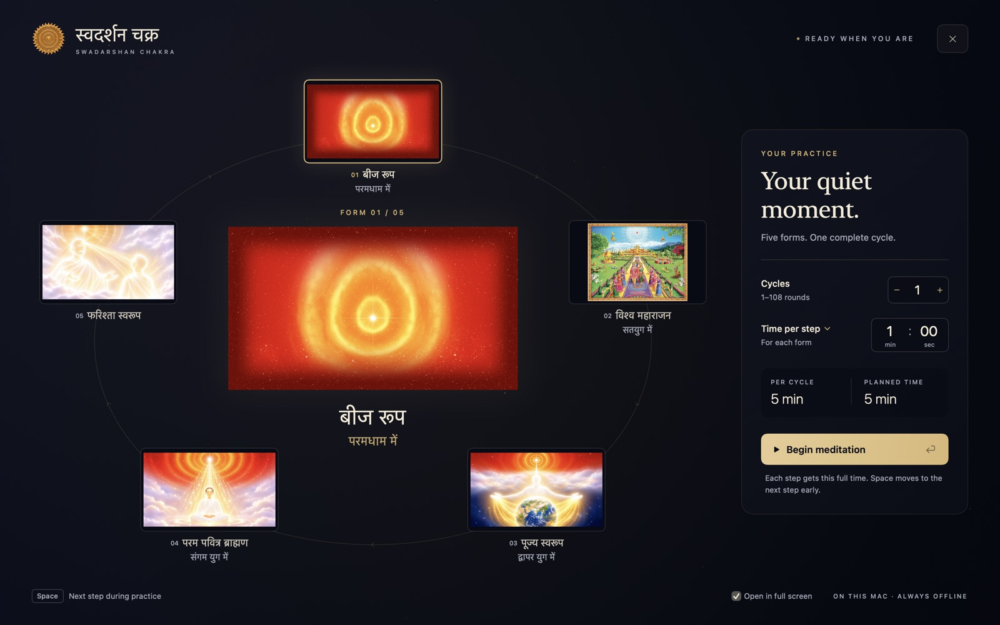
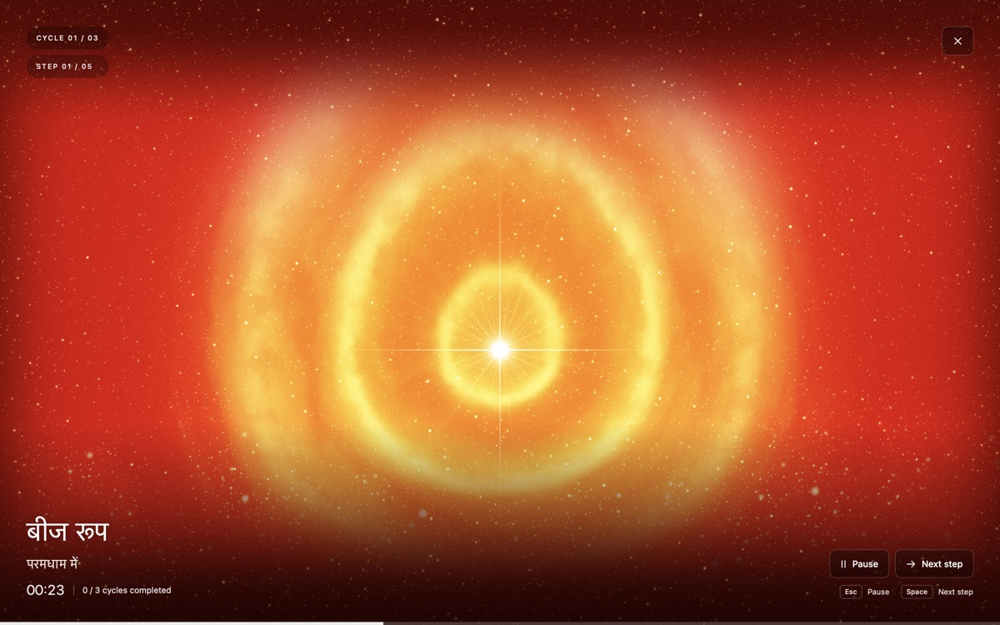
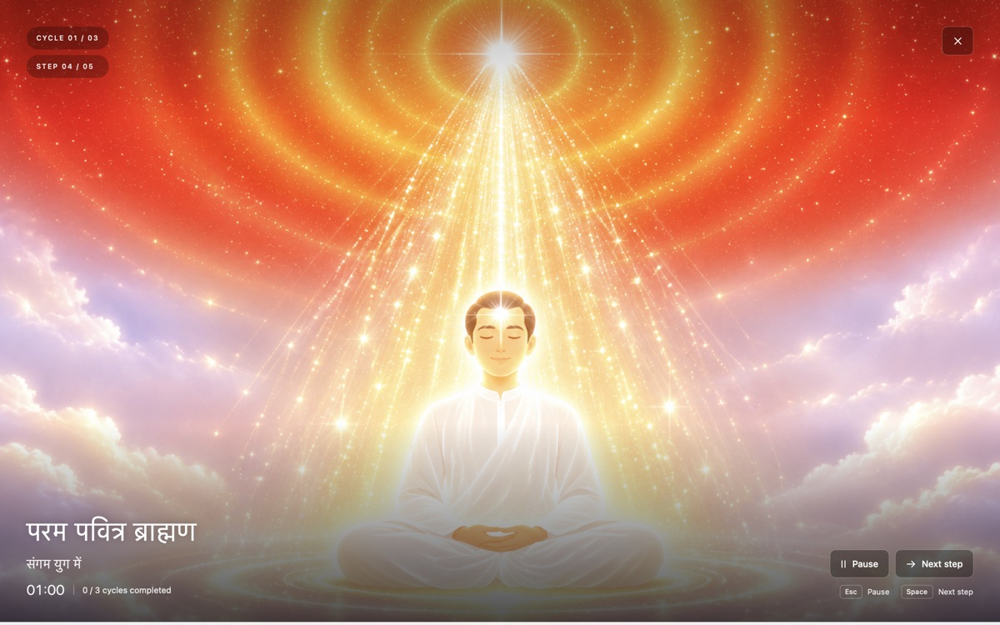
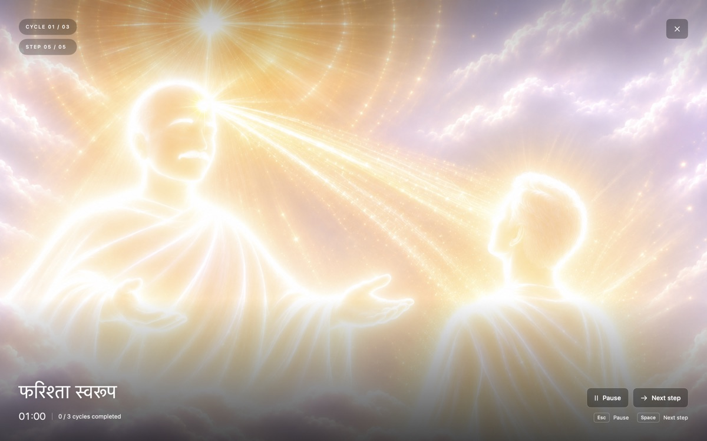
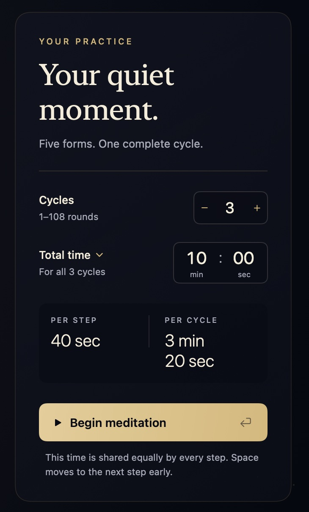
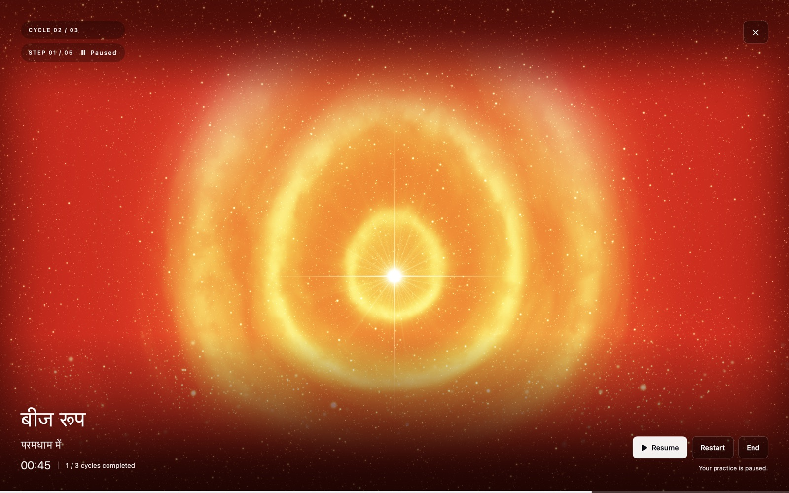
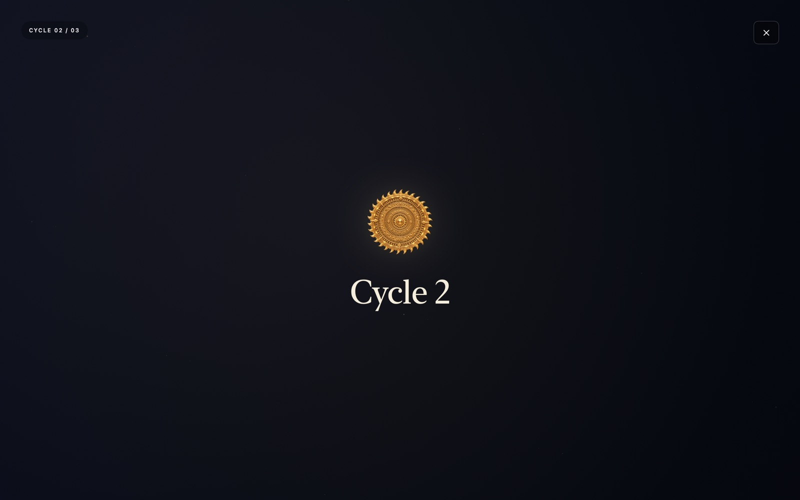
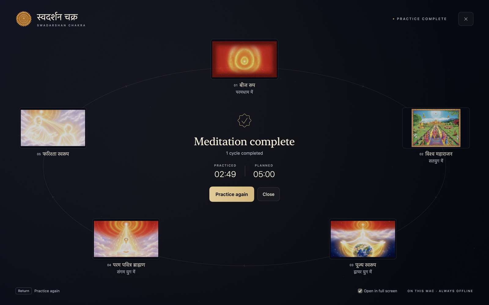

<p align="center">
  
</p>

<h1 align="center">Swadarshan Chakra</h1>

<p align="center">
  <b>स्वदर्शन चक्र</b> · a calm, full-screen companion for the Swadarshan Chakra meditation on your Mac
</p>

<p align="center">
  <a href="https://github.com/shivam13juna/Swadarshan-Chakra/releases/latest"><b>Download for Mac</b></a> · <a href="https://swadarshan-chakra.web.app"><b>Practice in your browser</b></a>
  <br>
  <sub>Mac app: macOS 13 Ventura or later · Apple Silicon · Free · Works entirely offline</sub>
</p>

<br>



## What it does

Swadarshan Chakra guides you through five consecutive forms of spiritual self-awareness, one at a time. Each form's picture fills your screen while you contemplate it. When its time is up, the next form begins, and after the fifth, the circle starts again. One pass through all five forms is a **cycle**.

You choose how many cycles to practice and how much time to give them. The app keeps time, so you don't have to.

No Mac, or nothing to install? The same practice runs in any modern browser at **[swadarshan-chakra.web.app](https://swadarshan-chakra.web.app)**, on a computer or a phone. Your settings stay in that browser.

### The five steps

<table>
  <tr>
    <td align="center" width="50%">
      <br>
      <b>1 · बीज रूप</b> — परमधाम में<br>
      <sub>Beej roop, Paramdham me</sub>
    </td>
    <td align="center" width="50%">
      <br>
      <b>2 · विश्व महाराजन</b> — सतयुग में<br>
      <sub>Vishwa Maharajan, Satyug me</sub>
    </td>
  </tr>
  <tr>
    <td align="center" width="50%">
      <br>
      <b>3 · पूज्य स्वरूप</b> — द्वापर युग में<br>
      <sub>Pujya Swaroop, Dwapar Yug me</sub>
    </td>
    <td align="center" width="50%">
      <br>
      <b>4 · परम पवित्र ब्राह्मण</b> — संगम युग में<br>
      <sub>Param Pavitra Brahmin, Sangam Yug me</sub>
    </td>
  </tr>
  <tr>
    <td align="center" colspan="2">
      <br>
      <b>5 · फरिश्ता स्वरूप</b><br>
      <sub>Farishta Swaroop</sub>
    </td>
  </tr>
</table>

## Install

1. Download **Swadarshan-Chakra-…-macOS-arm64.zip** from the [latest release](https://github.com/shivam13juna/Swadarshan-Chakra/releases/latest).
2. Open the zip and drag **Swadarshan Chakra** into your **Applications** folder.
3. Open it. The first time, macOS says it can't verify the app, because it isn't notarized by Apple. Click **Done**, open **System Settings → Privacy & Security**, scroll down, and click **Open Anyway**. You only need to do this once.

Swadarshan Chakra lives in your **menu bar** as a small gold chakra. Click it to open the meditation; right-click it to quit.

> [!NOTE]
> On an Intel Mac, build the app from source. See [For developers](#for-developers).

## Your practice, step by step

### 1. Set it up



**Cycles:** anywhere from 1 to 108.

**Time:** click the drop-down to choose how you'd like to set it.

- **Time per step** gives every form the time you enter.<br>*1 minute per step → 5 minutes per cycle.*
- **Total time** is the time you have for the whole practice, shared equally by every step.<br>*10 minutes for 3 cycles → 40 seconds per step.*

The panel shows what your choice works out to. Press **Begin meditation** (or <kbd>Return</kbd>). Your settings are remembered for next time.

<br clear="right">

### 2. Meditate

Each step fills your screen, as in [the five steps](#the-five-steps) above.

- The current **cycle** and **step** are in the top-left corner. The form's name and the time remaining are at the bottom.
- When a step's time is up, the next one begins by itself. Ready sooner? Press <kbd>Space</kbd>.
- <kbd>Esc</kbd> pauses. From there you can resume, restart, or end the practice.
- If you switch to another app, close the window, or your Mac goes to sleep, the practice pauses and waits for you. Nothing moves on while you're away.



### 3. A moment between cycles



Each cycle opens with a short card: *Cycle 1*, *Cycle 2*, and so on. After three seconds the first step begins on its own. The card isn't counted as practice time, and every step still gets its full time.

### 4. Finish



When the last cycle ends, you'll see how many cycles you completed and how long you actually practiced. Press <kbd>Return</kbd> to practice again.

## Full screen or a window

Meditation opens in full screen, so nothing else competes for your attention. If you'd rather use an ordinary window, untick **Open in full screen** at the bottom of the setup screen.

You can also switch at any time, as in any Mac app: click the green window button (in full screen, move your pointer to the top of the screen to reveal it), choose **View ▸ Enter Full Screen**, or press <kbd>⌃</kbd> <kbd>⌘</kbd> <kbd>F</kbd>.

## Keyboard shortcuts

| Keys | Action |
|---|---|
| <kbd>Return</kbd> | Begin · Resume · Practice again |
| <kbd>Space</kbd> | Next step, or start a cycle right away from its card |
| <kbd>Esc</kbd> | Pause |
| <kbd>⌘</kbd> <kbd>R</kbd> / <kbd>⌘</kbd> <kbd>E</kbd> | Restart / End, while paused (asks first) |
| <kbd>⌘</kbd> <kbd>Return</kbd> | Confirm restart, end, or quit |
| <kbd>⌃</kbd> <kbd>⌘</kbd> <kbd>F</kbd> | Enter or leave full screen |
| <kbd>⌘</kbd> <kbd>M</kbd> | Minimize, in a window |
| <kbd>⌘</kbd> <kbd>W</kbd> | Close to the menu bar; your practice pauses and waits |
| <kbd>⌘</kbd> <kbd>Q</kbd> | Quit (asks first if a practice is under way) |

Holding <kbd>Space</kbd> down never skips more than one step.

## Privacy

Everything happens on your Mac. There are no accounts, no tracking, and no internet connection: the app never goes online. Your settings are stored only on this Mac.

## For developers

<details>
<summary><b>Build, check, and release</b></summary>
<br>

Requires macOS 13 or later and Swift 5.9 or later. Apple's Command Line Tools are enough; there are no third-party dependencies.

```sh
# Build the app into dist/ and open it
./scripts/build-app.sh --launch

# Verify the artwork, run the core checks, and compile
./scripts/check.sh
```

`build-app.sh` makes a release build for this Mac's architecture, embeds the five pictures and the icon, and signs the app locally (ad hoc). Add `--debug` for a debug build.

The app also has built-in checks:

```sh
APP="dist/Swadarshan Chakra.app/Contents/MacOS/SwadarshanChakra"
"$APP" --verify-resources            # the packaged app decodes all five pictures
"$APP" --verify-timer                # live 3-second cycle card and 12-second step; about 16 s, no window
"$APP" --smoke-test                  # drives the real full-screen window; about 45 s, takes over the screen
"$APP" --render-previews <folder>    # renders every screen to PNG, as used for the screenshots here
```

**Web version.** `web/` is the same practice for the browser, with no build step. `engine.js` is a port of `MeditationCore`; `Tests/web/engine-checks.mjs` mirrors the core checks, and `check.sh` runs it when Node is installed. `app.js` and `app.css` follow the SwiftUI screens. Preview it locally with `firebase serve --only hosting`.

**Publishing.** Pushing to `main` publishes both:

- **The Mac app.** The [release workflow](.github/workflows/release.yml) runs when a push changes the app. It runs the checks, then builds, signs, and verifies the app. It publishes `Swadarshan-Chakra-<version>-macOS-arm64.zip`, with a SHA-256 checksum, as release `v<version>`, using `CFBundleShortVersionString` from `packaging/Info.plist`. A new version gets a new release. Otherwise the current version's release gets the new build, and its tag moves to that commit.
- **The website.** The [website workflow](.github/workflows/website.yml) runs when a push changes `web/`. It checks the engine and deploys to Firebase Hosting, using the `FIREBASE_SERVICE_ACCOUNT` repository secret. That secret is a key for the `github-deploy` service account, which can only manage Hosting.

Either workflow can also be run by hand from the Actions tab. Removing the Mac app's first-launch prompt would require Apple notarization with a Developer ID.

**Project layout**

| Path | Contents |
|---|---|
| `Sources/MeditationCore` | Settings, the five forms, and the session state machine: timing, cycles, pause, and Space |
| `Sources/SwadarshanChakra` | The macOS app: the menu bar item, the window and full screen, and the SwiftUI screens |
| `Tests/MeditationCoreTests` | 37 deterministic checks that run without Xcode |
| `web` | The web version, published to [swadarshan-chakra.web.app](https://swadarshan-chakra.web.app) |
| `Tests/web` | Node checks for the web version's engine |
| `docs` | The screenshots and icon this README uses |
| `5_pictures` | The five original pictures. The bundled copies must match them byte for byte, and `Stage.swift` maps each to its form |
| `scripts` | Build, check, icon, and artwork-verification scripts |

[VERIFICATION.md](VERIFICATION.md) records what has been verified and how; [prd_v2.md](prd_v2.md) is the product specification.

</details>
